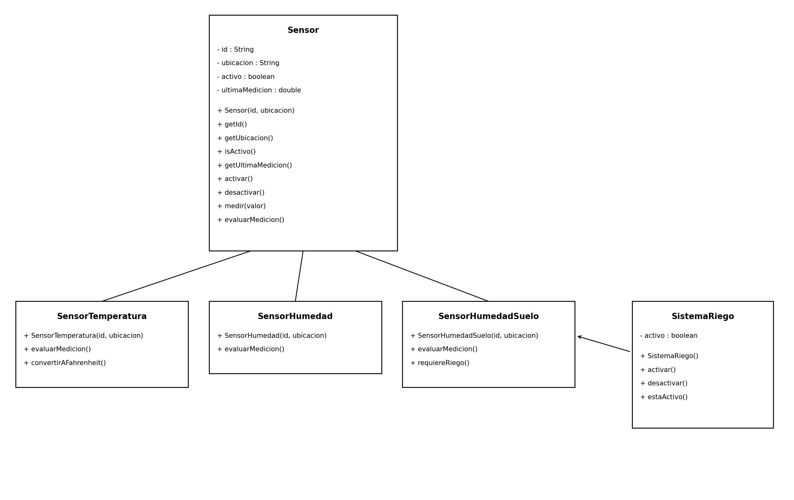

Analisis y diseño de un sistema de invernadero inteligente

Integrante: Axel Iván Breña Torres

fecha de inicio: 1 de octubre de 2026

--------------

## 1. Descripción del problema

El sistema que hay que hacer es un invernadero con sensores, se 
 miden tres cosas (la temperatura del aire,
la humedad del ambiente y la humedad del suelo), 
y cada una tiene su propio sensor, también hay un sistema de
riego que solo puede estar activo o inactivo.

El programa tiene que manejar datos 
para cada sensor como quién es (un id), donde está instalado,
si está activo y cuánto
midió la última vez.

Lo que tiene que hacer el sistema es recibir una medición e interpretarla 
(baja, adecuada o alta) y con la
humedad del suelo decidir si hay que regar, 
si el suelo está seco se activa el riego y si está adecuado o
alto no hace falta.

Algo que hay qye consideras es que los tres sensores
se parecen mucho pero no interpretan igual el número,
un 32 es temperatura alta, pero en humedad ambiental 
es baja y en humedad del suelo es adecuada, or eso creo
que aquí sirve la herencia, para tener una parte que sea
igual en todos los sensores y otra que cambie en cada uno.

--------
## 2. Identificación de objetos

Los objetos que identifiqué son estos:

- sensor: es la base para el sensor, es necesario porque todos los sensores
  del invernadero comparten datos (id, ubicación, si está activo
, última medición) y no es eficiente repetirlos
tres veces, en pocas palabras guarda información en común

- sensorTemperatura: Es el sensor que mide la temperatura del aire 
en grados centigrados es necesario porque interpreta la medición con 
base en sus rengos propios, su función es decir si la
temperatura es baja, adecuada o alta.

- sensorHumedad. Mide la humedad ambiental en un porcentaje %

- SensorHumedadSuelo. Mide la humedad del suelo en un porcentaje %
y puede decir si hace
  falta regar.

- SistemaRiego. No mide nada,  solo está activo o inactivo y se puede prender o apagar, 
su función es controlar el riego.

---------

# 3. Estado y comportamiento

| Objeto | Función                                          | Información del objeto| Comportamiento                                                                                                             |
|---|--------------------------------------------------|------------------------------------------------------|----------------------------------------------------------------------------------------------------------------------------|
| Sensor | Guardar los datos en común de todos los sensores | id ubicación si está activo última medición | puede activarse y desactivarse puede guardar una medición puede consultar sus datos puede interpretar su medición |
| SensorTemperatura | Interpretar mediciones de temperatura            | Lo mismo que Sensor                                  | Interpretar su medición con los rangos de temperatura puede convertir su medición a Fahrenheit                          |
| SensorHumedad | Interpretar mediciones de humedad ambiental      | Lo mismo que Sensor                                  | Interpretar su medición con los rangos de humedad ambiental                                                                |
| SensorHumedadSuelo | Interpretar mediciones de humedad del suelo      | Lo mismo que Sensor                                  | Interpretar su medición con los rangos del suelo pude saber si hace falta regar                                         |
| SistemaRiego | Controlar si se está regando o no                | Si está activo o no                                  | puede activarse puede desactivarse puede consultar su estado                                                         |

-------

# 4. Características comunes y especialización

comparando los tres sensores del documento de contexto las respuestas son:

¿qué información tienen en común? el id, la ubicación, si están activos o inactivos y la última medición

¿qué comportamientos tienen en común? activarse o desactivarse, guardar una medición, consultar sus datos y también interpretar la medición

¿qué cambia según el tipo de sensor? la unidad (°C o %) y los rangos del número

¿existe un concepto general para todos? si, es el sensor sin contemplar que mide

¿qué serían las especializaciones? el sensor de temperatura, el de humedad ambiental y el de humedad del suelo

| Sensor | Baja | Adecuada | Alta |
|---|---|---|---|
| Temperatura | menor a 18 | de 18 a 30 | mayor a 30 |
| Humedad ambiental |menor a 40 |de 40 a 70 | mayor a 70 |
| Humedad del suelo |menor a 30 |de 30 a 70 | mayor a 70 |

Todos interpretan su medición, pero cada uno lo hace distinto. Entonces el comportamiento existe en todos y la
forma de hacerlo cambia en cada subclase.

---

# 5. Relaciones entre objetos

separé las relaciones en dos tipos:

(herenciia):

un SensorTemperatura es un Sensor

un SensorHumedad es un Sensor

un SensorHumedadSuelo es un Sensor

(sin herencia):

el sistema de riego usa la información del sensor de humedad
del suelo para saber si se tiene que activar, necesita saber si la humedad
está baja y eso se lo da el sensor

No se deben de duplicar los datos comunes de los sensores van solo en sensor  y el sistema 
de riego no guarda su propia copia de la humedad del suelo, se la pide al sensor cuando la necesita.

¿por qué SistemaRiego no debería ser una subclase de Sensor? porque no cumple con la herencia,
un sistema de riego no es un sensor ya queno mide nada y no tiene una medición que interpretar
, el sensor solo observa y el riego hace la acción, tienen responsabilidades diferente, si lo
pongo como subclase heredaría cosas que no necesita como la última medición o evaluarMedicion() y no tendría sentido.

---------------------

# 6. Diseño de clases

| Clase | Atributos propuestos | Tipo de dato                          | Métodos propuestos                                                                                                               | Responsabilidad                                        |
|---|---|---------------------------------------|----------------------------------------------------------------------------------------------------------------------------------|--------------------------------------------------------|
| Sensor | id ubicacion activo ultimaMedicion | String String boolean double | getId() getUbicacion() isActivo() getUltimaMedicion() activar() desactivar() medir(valor) evaluarMedicion() | Guardar los datos comunes de cualquier sensor          |
| SensorTemperatura | (los hereda de Sensor) |                                       | evaluarMedicion() convertirAFahrenheit()                                                                                      | Interpretar temperaturas                               |
| SensorHumedad | (los hereda de Sensor) |                                       | evaluarMedicion()                                                                                                                | Interpretar humedad ambiental                          |
| SensorHumedadSuelo | (los hereda de Sensor) |                                       | evaluarMedicion() requiereRiego()                                                                                             | Interpretar humedad del suelo y decir si hay que regar |
| SistemaRiego | activo | boolean                               | activar() desactivar() estaActivo()                                                                                        | Controlar el riego                                     |

sensor: el constructor recibe el id y la ubicación, el atributo activo empieza en true y ultimaMedicion en 0
, los gets regresan String, String,
medir(valor) guarda la medición y evaluarMedicion() regresa un
texto

sensorTemperatura, sensorHumedad y sensorHumedadSuelo: cada una tiene un constructor con id y ubicación
que llama a sensor(id, ubicacion) y no vuelve a declarar los atributos, evaluarMedicion() regresa String,
convertirAFahrenheit() regresa double y requiereRiego() regresa booleano (true si la humedad está baja)

sistemaRiego: el constructor no recibe nada y empieza con el estado de activo en false, estaActivo()
regresa valores booleanos y revisarSuelo(sensor) recibe un SensorHumedadSuelo y activa o desactiva
el riego dependiendo lo que le diga el sensor
----
## 7. Jerarquía de clases

la clase principal  es Sensor y de ahí se heredan tres subclases: SensorTemperatura,
SensorHumedad y SensorHumedadSuelo, las tres son un tipo de sensor y reciben
de Sensor el id, la ubicación, el estado y la última medición.

SistemaRiego queda fuera de la jerarquía porque no hereda nada, es una clase
aparte que solo usa la información del sensor de humedad del suelo.

------
## 8. UML inial

---

# 10. Constructores y super

1. ¿Los constructores de la superclase se heredan? No. Una subclase no hereda los constructores por eso
   cada subclase tiene el suyo y dentro llama al de Sensor con super(id, ubicacion)
2. Cuando creo un objeto de una subclase, ¿qué constructor se ejecuta primero? El de la superclase lo
   comprobé en el serial al crear un SensorTemperatura sale primero "ejecutando el constructor de Sensor"
   y después "ejecutando el constructor de SensorTemperatura"
3. ¿Para qué usé super(...)? Para pasarle el id y la ubicación al constructor de Sensor, que es el que
   guarda esos datos

---

# 11. Sobrescritura

1. ¿Qué método sobrescribí? evaluarMedicion() y está en Sensor 

2. ¿Qué indica @Override? Que ese método reemplaza uno de la superclase

3. ¿Por qué usé el mismo nombre en las subclases? Porque los tres sensores hacen lo mismo en general
   pero con condiciones distintas

4. ¿Qué ventaja tiene frente a un método distinto para cada tipo? Si tuviera evaluarTemperatura()
   evaluarHumedad() y evaluarSuelo(), tendría que saber de qué tipo es cada objeto para llamar al correcto

---

# 12. Polimorfismo y enlace dinámico

| Tipo de referencia | Tipo real del objeto | Método que se ejecuta                                                        |
|---|---------------|------------------------------------------------------------------------------|
| Sensor | SensorTemperatura | evaluarMedicion() de SensorTemperatura (con 32 da "temperatura alta")        |
| Sensor | SensorHumedad | evaluarMedicion() de SensorHumedad (con 55 da humedad ambiental adecuada")   |
| Sensor |SensorHumedadSuelo| evaluarMedicion() de SensorHumedadSuelo (con 22 da "humedad del suelo baja") |

1. ¿Por qué una referencia de tipo Sensor puede apuntar a un objeto SensorTemperatura? Porque un
   SensorTemperatura es un Sensor de herencia entonces cabe en una variable de ese tipo.
2. ¿Puede una referencia SensorTemperatura apuntar a cualquier objeto Sensor? No porque un Sensor cualquiera
   podría ser un SensorHumedad, que no tiene convertirAFahrenheit()
3. Cuando ejecuto sensor.evaluarMedicion(), ¿qué versión se ejecuta? La del tipo real del objeto no la del
   tipo de la variable.
4. ¿Cómo decide Java cuál usar? Lo decide mientras el programa corre viendo cual es la clase del objeto realmente
5. ¿Dónde se observa el polimorfismo? En el for de Main que recorre el arreglo Sensor, es el mismo código
   para los tres sensores y cada uno responde distinto.
6. ¿Dónde se observa el enlace dinámico? En esa misma línea de sensor.evaluarMedicion()x